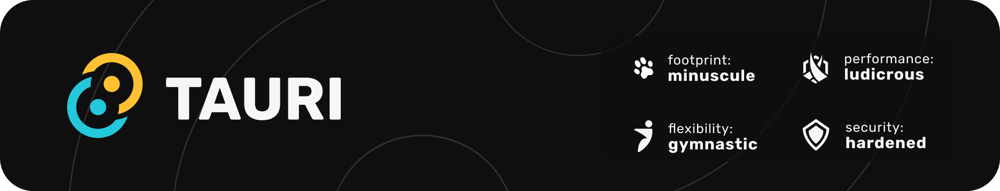

> 本文档是 [README.md](README.md) 的中文翻译，若两者有出入，以英文原版为准。



[](https://github.com/tauri-apps/tauri/tree/dev)
[](https://opencollective.com/tauri)
[](https://github.com/tauri-apps/tauri/actions/workflows/test-core.yml)
[](https://app.fossa.com/projects/git%2Bgithub.com%2Ftauri-apps%2Ftauri?ref=badge_shield)
[](https://discord.com/invite/tauri)
[](https://tauri.app)
[](https://good-labs.github.io/greater-good-affirmation)
[](https://opencollective.com/tauri)

## 简介

Tauri 是一个为所有主流操作系统构建体积极小、速度极快的二进制程序的框架。开发者可以集成任何能编译为 HTML、JS 和 CSS 的前端框架来构建用户界面。应用的后端是一个由 Rust 编写的二进制程序，并提供可供前端交互的 API。

Tauri 应用的用户界面目前在 macOS、Windows、Linux、Android 和 iOS 上使用 [`tao`](https://docs.rs/tao) 作为窗口管理库。为了渲染应用，Tauri 使用 [WRY](https://github.com/tauri-apps/wry)——一个为系统 WebView 提供统一接口的库：在 macOS 和 iOS 上使用 WKWebView，在 Windows 上使用 WebView2，在 Linux 上使用 WebKitGTK，在 Android 上使用 Android System WebView。

想了解这些组件如何协同工作的更多细节，请参阅 [ARCHITECTURE.md](https://github.com/tauri-apps/tauri/blob/dev/ARCHITECTURE.md) 文档。

## 快速上手

如果你有兴趣开发 Tauri 应用，请访问[文档网站](https://tauri.app)。

最快的入门方式是为你的系统安装[前置依赖](https://v2.tauri.app/start/prerequisites/)，然后使用 [`create-tauri-app`](https://github.com/tauri-apps/create-tauri-app/#usage) 创建新项目。例如使用 `npm`：

```sh
npm create tauri-app@latest
```

## 特性

Tauri 的特性包括但不限于：

- 内置应用打包器，可生成 `.app`、`.dmg`、`.deb`、`.rpm`、`.AppImage` 等格式的应用包，以及 `.exe`（通过 NSIS）和 `.msi`（通过 WiX）等 Windows 安装程序。
- 内置自更新器（仅限桌面端）
- 系统托盘图标
- 原生通知
- 原生 WebView 协议（Tauri 不会创建 localhost http(s) 服务器来提供 WebView 内容）
- 用于简化 CI 流程的 GitHub Action
- VS Code 扩展

### 支持的平台

Tauri 目前支持在以下平台上进行开发和分发：

| 平台       | 版本                                                                                                            |
| :--------- | :-------------------------------------------------------------------------------------------------------------- |
| Windows    | 10 及以上                                                                                                       |
| macOS      | 10.15 及以上                                                                                                    |
| Linux      | Tauri v1 需要 webkit2gtk 4.0（例如 Ubuntu 18.04）；Tauri v2 需要 webkit2gtk 4.1（例如 Ubuntu 22.04）。            |
| iOS/iPadOS | 9 及以上                                                                                                        |
| Android    | 7 及以上（目前为 8 及以上）                                                                                     |

## 参与贡献

在开始着手某项工作之前，最好先检查是否已有相关的 issue。也建议到 Discord 服务器与团队确认这件事是否值得做，或者是否已经有人在做。

在提交 pull request 之前，请务必阅读[贡献指南](./.github/CONTRIBUTING.md)。

感谢每一位为 Tauri 做出贡献的人！

### 文档

在多语言混合的系统中编写文档是一件棘手的事。为此，我们倾向于尽可能在 Rust 和 JS 源代码中编写内联文档。更多信息请查看文档网站的托管仓库：<https://github.com/tauri-apps/tauri-docs>

## 合作伙伴

<table>
  <tbody>
    <tr>
      <td align="center" valign="middle">
        <a href="https://crabnebula.dev" target="_blank">
          
        </a>
      </td>
    </tr>
  </tbody>
</table>

完整的赞助商列表请访问我们的[网站](https://tauri.app#sponsors)和 [Open Collective](https://opencollective.com/tauri)。

## 组织

Tauri 致力于成为一个遵循可持续自由与开源软件社区指导原则的可持续集体。为此，它已成为 [Commons Conservancy](https://commonsconservancy.org/) 旗下的一个项目（Programme），你可以通过 [Open Collective](https://opencollective.com/tauri) 提供资金支持。

## 许可证

代码：(c) 2015 - 至今 - The Tauri Programme within The Commons Conservancy。

MIT，或在适用情况下为 MIT/Apache 2.0。

Logo：CC-BY-NC-ND

- Tauri 原始 Logo 由 [Alve Larsson](https://alve.io/)、[Daniel Thompson-Yvetot](https://github.com/nothingismagick) 和 [Guillaume Chau](https://github.com/akryum) 设计

[](https://app.fossa.com/projects/git%2Bgithub.com%2Ftauri-apps%2Ftauri?ref=badge_large)